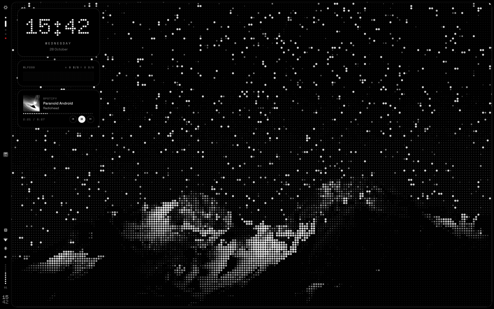
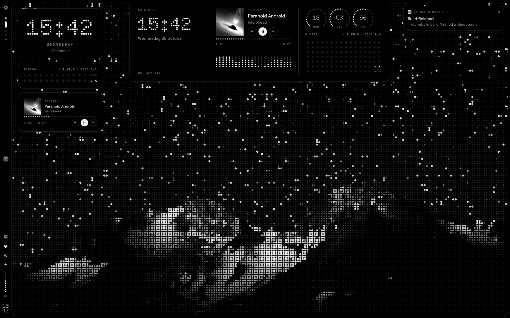
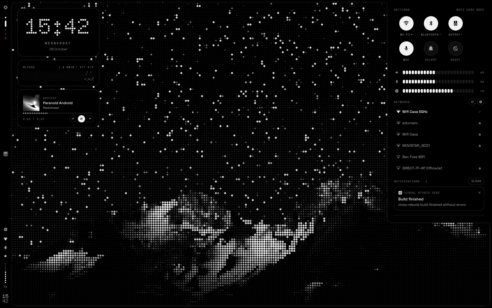
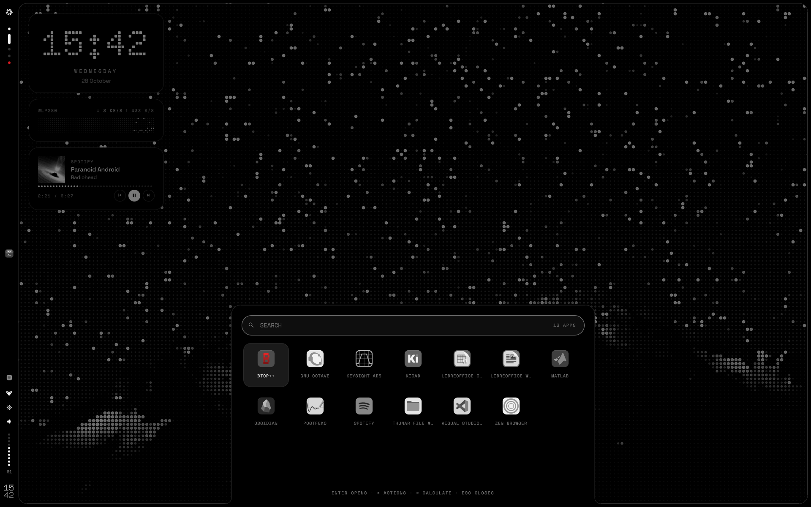
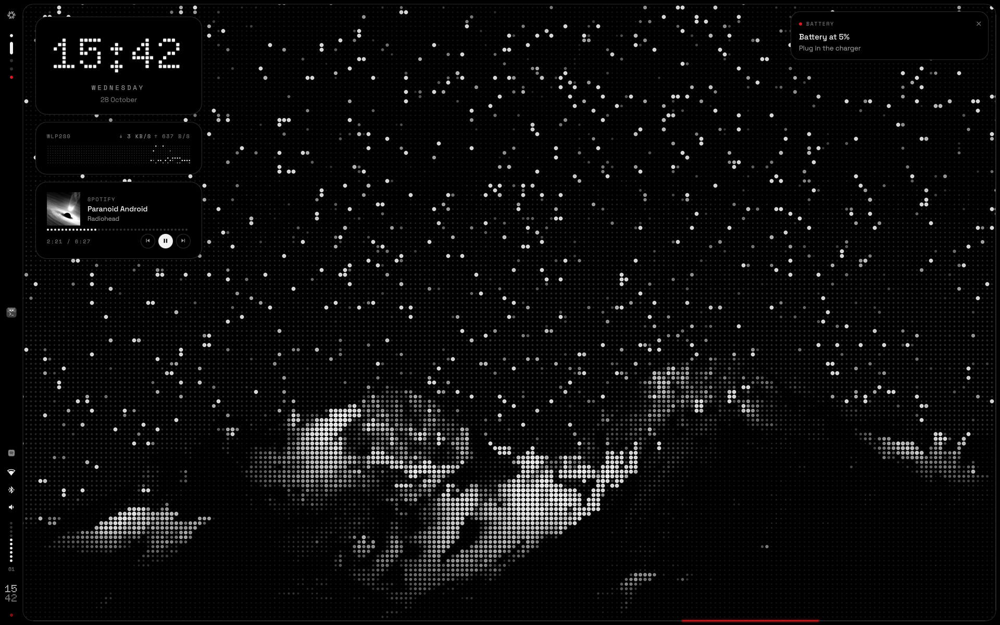
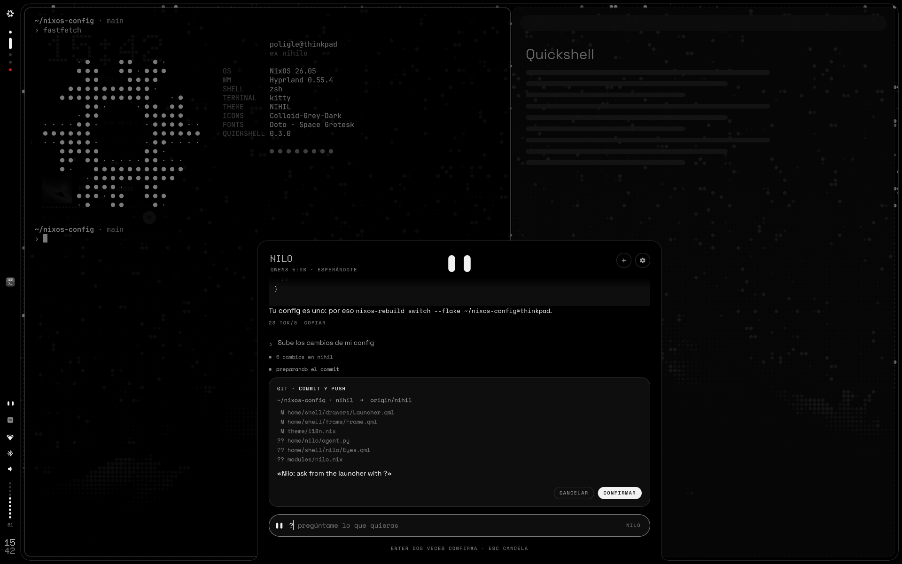

<p align="center">
  <picture>
    <source media="(prefers-color-scheme: dark)" srcset="assets/brand/nihil-logo-dark.svg">
    
  </picture>
</p>

<p align="center"><b>ex nihilo</b> &nbsp;·&nbsp; a monochrome, dot-matrix desktop for NixOS</p>

<p align="center">
  <a href="https://nihilshell.com/">Website</a> &nbsp;·&nbsp;
  <a href="#install">Install</a> &nbsp;·&nbsp;
  <a href="#options">Options</a> &nbsp;·&nbsp;
  <a href="#keybindings">Keybindings</a> &nbsp;·&nbsp;
  <a href="https://github.com/poligle/Nihil-Launcher">Launcher for Android</a>
</p>



NIHIL is my NixOS configuration for `poligle@thinkpad`. It takes the structure of
[Caelestia](https://github.com/caelestia-dots/shell) — a frame around the screen with
drawers that grow out of it — and dresses it in the language of Nothing: monochrome,
dot-matrix type, red only to interrupt, and light that runs along the edge.

Everything is declarative: Flakes, Home Manager, Stylix and a shell written from scratch
in [Quickshell](https://quickshell.org). One file, [`theme/nihil.nix`](theme/nihil.nix),
holds the design tokens, and every layer — GTK, terminal, editor, compositor, lock
screen, greeter, boot splash and the shell — is generated from it.

> *Nihil* is Latin for "nothing", the way *caelestia* is Latin for "the heavenly".
> *Ex nihilo* — from nothing — is also what NixOS does: the whole system, rebuilt from a
> declaration.

**On the phone, too:** [NIHIL for Android](https://github.com/poligle/Nihil-Launcher) is a
home screen in the same language — the frame, an LED clock, the light on the edge — with
no internet permission ([nihilshell.com/android](https://nihilshell.com/android/)).

---

## Highlights

- **Frame and bar.** One black shape around every screen. Its left side widens into the
  bar: NixOS mark, workspaces as LEDs, the active app, tray, status, a 10-LED battery
  gauge, the clock in dots and a red privacy LED while something records the mic.
- **Drawers.** The dashboard, the settings panel and the launcher are bumps of the frame
  itself, with concave joints, so they look like part of the hardware.
- **Dashboard.** Time, music with the cover rendered as a dot matrix and a spectrum in
  LED columns, CPU/RAM/temperature dials and a network oscilloscope.
- **Settings.** Circular toggles, segmented sliders, Wi-Fi (with passwords and
  WPA-Enterprise hand-off), Bluetooth, audio output, notification history, session.
- **Launcher.** Monochrome app grid that regains colour on the selection, `>` for
  actions, `=` for a calculator, `?` for Nilo.
- **Nilo, optional.** An assistant with a local model (Qwen 3.5 on Ollama): two white eyes
  that wake up while you type, answer, search the web if you let them and, asking you
  first, commit and push your config. It falls asleep and frees the memory after a few
  minutes. See [Nilo](#nilo).
- **Light on the edge.** In the spirit of Nothing's Glyph Interface, every notification
  sends a segment of light around the frame; critical ones run twice, in red. Plugging the
  charger lights it from the left.
- **Wallpapers as LED matrices.** Every image in `wallpapers/` is rendered at build time
  as dots, once per output at its native size, so each dot lands on exact pixels.
- **Boot, login, lock.** The NixOS snowflake switching on LED by LED (Plymouth), a dotted
  greeter (ReGreet) and a lock screen with the password drawn as dots (hyprlock).
- **fastfetch in dots.** The same snowflake, drawn with `●` and `·`, and monochrome keys.
- **Spanish or English.** One option switches every string of the shell, the lock screen,
  the greeter and the scripts, and the language of their dates.
- **Its own sound.** A set of short digital blips, synthesised by
  [`tools/sounds.py`](tools/sounds.py); the previous sounds are one option away.

| | |
|:---:|:---:|
|  |  |
| Dashboard — hover the top edge or `SUPER + D` | Settings — `SUPER + P`, the status icons or the top-right corner |
|  |  |
| Launcher — `SUPER + Space`, three fingers up or the bottom edge | A critical notification and its red light |

<sub>The screenshots are the shell rendered in a test harness with sample data: the
networks, the track and the notifications are made up. App icons are Colloid's.</sub>

---

## Design language

Three rules come before everything else:

1. **Hierarchy is made with greys.** Red is never decoration: it only interrupts — a
   failed login, a critical notification, the recording LED, a destructive action.
2. **Dots are for display.** Doto draws the clock and the big numbers; text stays in
   Space Grotesk, labels in uppercase Space Mono.
3. **The frame is hardware.** Opaque, flat, no shadows; windows sit concentric with it.

| Token     | Hex       | Use                                   |
|-----------|-----------|---------------------------------------|
| `void`    | `#000000` | Frame, bar, drawers                   |
| `surface` | `#0E0E0E` | Cards inside drawers                  |
| `raised`  | `#1A1A1A` | Hover, slider tracks                  |
| `line`    | `#2A2A2A` | 1 px lines                            |
| `off`     | `#333333` | LEDs that are off                     |
| `muted`   | `#7A7A7A` | Metadata, inactive icons (4.89:1)     |
| `dim`     | `#A3A3A3` | Secondary text (8.33:1)               |
| `ink`     | `#F2F2F2` | Primary text, lit LEDs (18.76:1)      |
| `signal`  | `#D71921` | Interrupts only, never small text     |

Contrast ratios are against `#000000`. Fonts: [Doto](https://github.com/oliverlalan/Doto),
[Space Grotesk](https://github.com/floriankarsten/space-grotesk) and Space Mono (all SIL
OFL 1.1), plus JetBrains Mono Nerd Font for the terminal and glyphs. Icons: Colloid in
its grey variant; the shell shows app icons desaturated.

---

## Install

The repository is a NixOS flake with one host, `thinkpad`. To try it on another machine,
follow [Cloning to a new machine](#cloning-to-a-new-machine): the only host-specific
NIHIL settings are the outputs in `hosts/<name>/default.nix`.

```nix
nihil =
{
    primaryOutput = "eDP-1";
    wallpaper = "night";
    language = "es";          # or "en"
    outputs =
    {
        "eDP-1"    = { width = 1920; height = 1200; };
        "HDMI-A-1" = { width = 2560; height = 1440; };
        "DP-1"     = { width = 1080; height = 1920; bar = false; };   # vertical, no bar
    };
};
```

Output sizes are logical (after rotation): the wallpaper renders are made at exactly
that size. The first build downloads the Google Fonts source and renders every
wallpaper (a few seconds each).

---

## Options

All of them live under `nihil.*` ([`modules/nihil.nix`](modules/nihil.nix)).

| Option          | Default    | What it does                                                    |
|-----------------|------------|-----------------------------------------------------------------|
| `language`      | `"es"`     | `"es"` or `"en"`: shell, lock screen, greeter, script messages and their dates |
| `outputs`       | —          | Screens of the host: logical size, whether it has the bar, dot pitch |
| `primaryOutput` | —          | Screen for the desktop widgets, lock and login backgrounds      |
| `wallpaper`     | `"night"`  | Default wallpaper, a file name in `wallpapers/`                 |
| `soundPack`     | `"nihil"`  | `"nihil"` (`sounds/nihil`) or `"classic"` (the earlier sounds)  |
| `trayHidden`    | `[ "nm-applet" "blueman" ]` | Tray items to hide, by part of their id or title. The Wi-Fi and Bluetooth applets keep running for password and pairing prompts |
| `nilo.enable`   | `false`    | Nilo, the assistant, and Ollama to run its model ([Nilo](#nilo)) |
| `nilo.acceleration` | `"cpu"` | `"cpu"`, `"vulkan"`, `"rocm"` or `"cuda"`: what runs the model |
| `nilo.integratedGpu` | `false` | Let Ollama use an integrated GPU (it leaves them out by default) |
| `nilo.models`   | Qwen 3.5, 0.8B to 35B-A3B | Models offered in Nilo's settings |
| `nilo.contextLength` | `16384` | Context window, in tokens |
| `nilo.searxng`  | `null`     | A SearXNG instance for web searches instead of DuckDuckGo |

Read-only: `tokens` (the design tokens), `strings` (the selected language), `sounds`,
`wallpapers` and `fonts`. To add a language, add a block to
[`theme/i18n.nix`](theme/i18n.nix) and its code to the `language` enum.

---

## Keybindings

| Keys                              | Action                                        |
|-----------------------------------|-----------------------------------------------|
| `SUPER + Space`, 3 fingers up     | Launcher (`>` actions, `=` calculator; also by resting the pointer on the bottom edge) |
| `SUPER + I`, the Copilot key      | Nilo (also `?` in the launcher)               |
| `SUPER + D`                       | Dashboard (also by hovering the top edge)     |
| `SUPER + P`                       | Settings panel (or rest the pointer in the top-right corner) |
| `SUPER + K`                       | Lock                                          |
| `SUPER` (alone)                   | kitty                                         |
| `SUPER + E / X / N / C / S`       | Thunar, Zen, Obsidian, VS Code, Spotify       |
| `SUPER + Q`, 3 fingers down       | Close window                                  |
| `SUPER + V`                       | Toggle floating                               |
| `SUPER + F` / `SUPER + SHIFT + F` | Maximise / fullscreen                         |
| `SUPER + arrows`                  | Move focus                                    |
| `SUPER + 1…0`                     | Workspace (`SHIFT` moves the window there)    |
| `SUPER + Tab`, 3 fingers sideways | Next workspace / switch workspaces            |
| `SUPER + Escape`, 4 fingers       | Scratchpad (`SUPER + Ctrl` sends the window)  |
| `SUPER + H`                       | Colour picker                                 |
| `Print`                           | Region screenshot to the clipboard            |
| Volume, brightness, mic keys      | Change the value and show the OSD             |

Scrolling over the bar switches workspaces (on the LEDs) or changes the volume (on the
status icons).

---

## Shell

The shell lives in [`home/shell/`](home/shell) and runs as the `nihil-shell` user
service. [`home/shell.nix`](home/shell.nix) generates `Tokens.qml`, `Config.qml` and
`Lang.qml` from the Nix side and references every external program by its store path.

```bash
nihil-ipc drawers toggle launcher     # launcher | dashboard | panel
nihil-ipc osd volume 40 false
nihil-ipc glyph test true             # light the frame (critical = red)
nihil-ipc notifs toggleDnd
nihil-ipc nilo toggle                 # also: open, sleep, ask "…"
nihil-wallpaper next                  # also: prev, set <name>, list
journalctl --user -u nihil-shell -f   # logs
```

| Folder        | Contents                                                        |
|---------------|-----------------------------------------------------------------|
| `frame/`      | Frame geometry (one path with the drawers as bumps), Glyph light, bar |
| `drawers/`    | Dashboard, settings panel, launcher, OSD, notifications         |
| `background/` | Desktop widgets                                                 |
| `services/`   | Audio, network (nmcli), Bluetooth, battery, MPRIS, IPC, system stats, Nilo |
| `components/` | LEDs, dials, segmented sliders, dot-matrix image, buttons, text |
| `nilo/`       | Nilo: the eyes, the conversation, the introduction and its settings |

---

## Nilo



<sub>Rendered in the test harness: the conversation is the agent recorded against a scripted
model, not a real one.</sub>

An assistant in the launcher, with a model that runs on this computer. Two white eyes
on black: asleep while the model is unloaded, awake as soon as you type, looking up
while they think and from side to side while they search. It is meant for questions,
not for programming the config: it answers, searches the web, looks at this computer
and, if you allow it, commits and pushes the repository.

It is off by default. In the host:

```nix
nihil.nilo =
{
    enable = true;
    acceleration = "vulkan";   # or "cpu", "rocm", "cuda"
    integratedGpu = true;      # a laptop's Radeon or Intel GPU
};
```

That runs [Ollama](https://ollama.com) on `127.0.0.1` (`services.ollama`) and adds the
binds. The first time Nilo opens it introduces itself, shows how to call it, offers the
models that suit the RAM and asks what it may do.

| | |
|---|---|
| `SUPER + I`, the Copilot key | open or close Nilo |
| `?` in the launcher | the same, typed: `?what's a flake` |
| enter / esc | ask / stop the answer, or close |
| `ctrl + n` | new conversation |
| the eyes in the bar | the model is in memory; click to open |

**What it may do**, each one a switch in its settings (the gear): **Internet** — search
DuckDuckGo (through `ddgr`, or `nilo.searxng`) and read pages, never local addresses;
**This computer** — NixOS version and generation, memory, disk, battery; **Git** — `git
add -A`, commit and push in one repository (`~/nixos-config` by default). Every commit
shows its files and message first and needs enter twice, or a click. It cannot run
other commands or write files.

**Memory.** Ollama loads the model on the first question (Nilo starts loading it while
you type) and unloads it after the minutes chosen in the settings without questions: 5
by default. Asleep it takes no memory; Ollama itself stays as an idle service.

**Models.** Qwen 3.5 by default; any Ollama model with tools works, and models pulled
with `ollama pull` show up in the list.

| Model | Download | RAM, roughly | Recommended from |
|---|---|---|---|
| `qwen3.5:0.8b` | 1.3 GB | 2 GB | any |
| `qwen3.5:2b` | 2.7 GB | 3.5 GB | 8 GB |
| `qwen3.5:4b` | 3.4 GB | 5 GB | 12 GB |
| `qwen3.5:9b` | 6.6 GB | 8.5 GB | 20 GB |
| `qwen3.5:35b-a3b` | 22 GB | 25 GB | 56 GB |

The model, the switches, the minutes and "think before answering" apply at once and live
in `~/.local/state/nihil/nilo.json`; only the options above need a rebuild.

The agent behind it is [`home/nilo/agent.py`](home/nilo/agent.py), standard-library
Python that the shell talks to over stdin/stdout. Its tests run against a fake Ollama:
`python3 -m unittest home/nilo/test_agent.py`.

If it doesn't answer: `systemctl status ollama`, `journalctl --user -u nihil-shell` (the
agent logs there) and `ollama ps`. If the Copilot key does nothing, `wev` shows what it
sends; on Linux 6.14 and later it is `SUPER + SHIFT + F23`, which xkb calls
`XF86TouchpadOff`.

---

## Structure

```
nixos-config/
├── flake.nix · flake.lock · home.nix
├── theme/            Design system: tokens, i18n, fonts, wallpaper and boot renderers
│   ├── nihil.nix     palette, base16, fonts, frame geometry, motion
│   ├── i18n.nix      every string, per language
│   ├── dotmatrix.py  photo → LED matrix (wallpapers.nix runs it per output)
│   ├── plymouth.*    boot splash frames and theme
│   └── art/          LED maps of the NixOS snowflake (19 for fastfetch, 29 for boot)
├── hosts/thinkpad/   hardware, hostname, NIHIL outputs
├── modules/          system modules (nihil.nix, nilo.nix, stylix, plymouth, regreet, …)
├── home/             Home Manager: shell/, nilo/ (Nilo's agent), hyprland, hyprlock, …
├── sounds/           interface sounds (nihil/ is the NIHIL pack)
├── tools/            brand.py (logo, favicons, site images), sounds.py, snowflake.py
├── assets/brand/     logo and mark (SVG), social preview
├── docs/             the website, served by GitHub Pages from this folder
└── wallpapers/       source photos, rendered as dots at build time
```

---

## Daily usage

Rebuild the system after editing the configuration:

```bash
sudo nixos-rebuild switch --flake ~/nixos-config#<name> # or with the alias nrebuild
```

`nh os switch` does the same and also prints the package diff between generations.

Validate the configuration without building:

```bash
nix flake check # or with the alias ncheck
```

Build without activating (to test changes safely):

```bash
sudo nixos-rebuild build --flake ~/nixos-config#<name>
```

Update packages (equivalent to `pacman -Syu` from Arch):

```bash
nix flake update # or with the alias nupdate
sudo nixos-rebuild switch --flake ~/nixos-config#thinkpad
```

Manually clean up old generations:

```bash
sudo nix-collect-garbage --delete-older-than 7d # or with the alias ngc
```

> Garbage collection also runs automatically on a weekly basis (see `modules/nix.nix`).

---

## Recovery

- **System won't boot:** pick an earlier generation from the boot menu (systemd-boot).
  It's a system-level restore point.
- **A configuration broke something:** roll the repository back to a previous commit
  with Git (`git log`, `git revert`, `git checkout`), fix it, and rebuild. Git versions
  the *code*; generations version the *system*.

---

## Cloning to a new machine

1. Install base NixOS and generate the new machine's hardware config:

   ```bash
   sudo nixos-generate-config --show-hardware-config > /tmp/hardware-configuration.nix
   ```

2. Clone this repository:

   ```bash
   git clone git@github.com:poligle/nixos-config
   cd nixos-config
   ```

3. Create the new host:

   ```bash
   mkdir -p hosts/<name>
   cp /tmp/hardware-configuration.nix hosts/<name>/
   cp hosts/thinkpad/default.nix hosts/<name>/default.nix
   # edit hosts/<name>/default.nix: adjust networking.hostName
   ```

4. Add the new configuration to `flake.nix`:

   ```nix
    nixosConfigurations.thinkpad = nixpkgs.lib.nixosSystem 
		{
			system = "x86_64-linux";
			modules = [
				./hosts/thinkpad/default.nix
                stylix.nixosModules.stylix

				home-manager.nixosModules.home-manager
				{
					home-manager.useGlobalPkgs = true;
					home-manager.useUserPackages = true;

          home-manager.extraSpecialArgs = { inherit inputs; };
					home-manager.users.poligle = ./home.nix;
				}
			];
		};
   ```

5. Build:

   ```bash
   git add .
   sudo nixos-rebuild switch --flake .#<name>
   ```

Local state is not part of the repository and has to be set up again on each machine:
user password (`passwd`), SSH keys, fingerprint enrollment (`fprintd-enroll`) and the
engineering installs (`~/eda`, `~/.config/eda/licenses.env`).

---

## Technical details

- **Filesystem:** btrfs with subvolumes (`@`, `@home`, `@nix`, `@log`), zstd compression
  and `noatime`. Swap via zram.
- **Boot:** UEFI + systemd-boot with a systemd initrd and the NIHIL Plymouth theme
  (frames rendered at build time from `theme/art/snowflake-29.txt`).
- **Login:** greetd + ReGreet in cage on the last connected monitor, themed by Stylix
  plus NIHIL CSS.
- **Hyprland in Lua:** the whole configuration is declared in Nix and Home Manager
  generates `hyprland.lua`. Under Lua, dispatchers are Lua too
  (`hl.dsp.focus({ workspace = "e+1" })`); Quickshell 0.3 detects it (`Hyprland.usingLua`).
  Stylix's Hyprland target is off: NIHIL sets the colours itself.
- **Quickshell and Hyprland focus:** drawers that take the keyboard use
  `WlrKeyboardFocus.OnDemand` together with a `HyprlandFocusGrab`. `Exclusive` would not
  work: Hyprland drops every focus grab when a layer becomes exclusive.
- **Battery:** the shell reads it through UPower, which `modules/nihil.nix` enables.
- **Pre-existing files:** if a file Home Manager wants to manage already exists, it is
  renamed to `*.hm-backup` instead of aborting the activation.
- **Own scripts:** packaged with `writeShellScriptBin` and explicit dependencies:
  `osd-volume`, `osd-brightness`, `osd-mic`, `mic-led-sync`, `lock-screen`, `power-off`,
  `nihil-wallpaper`, `nihil-ipc`.
- **Engineering software:** GNU Octave and Python (numpy, scipy, matplotlib, scikit-rf)
  are declarative. MATLAB, Altair FEKO and Keysight ADS can't be packaged, so
  `home/engineering.nix` provides `eda-fhs`, an FHS sandbox with the libraries they
  expect, plus `matlab`, `feko` and `ads` launchers. Each one is installed from inside
  `eda-fhs` into `~/eda/{matlab,altair,keysight/ads}`; licence servers go in
  `~/.config/eda/licenses.env`, which stays out of the repo.

---

## Credits

- [Caelestia](https://github.com/caelestia-dots/shell) for the frame-and-drawers idea.
- [Nothing](https://nothing.tech) for the design language that inspired the look. NIHIL
  is a personal project and is not affiliated with Nothing Technology.
- [Quickshell](https://quickshell.org), [Hyprland](https://hyprland.org),
  [Stylix](https://github.com/nix-community/stylix) and
  [Home Manager](https://github.com/nix-community/home-manager).
- The NixOS snowflake (by Tim Cuthbertson, CC BY 4.0) is drawn as LEDs from the
  Material Design Icons glyph shipped with Nerd Fonts.
- Fonts: Doto, Space Grotesk and Space Mono (SIL OFL 1.1), JetBrains Mono (SIL OFL 1.1).
  The website ships subsets of the first three, with their licence in `docs/assets/fonts`.
- Icons: [Colloid](https://github.com/vinceliuice/Colloid-icon-theme) by Vince Liuice
  (GPL-3.0), installed from nixpkgs.

Code, sounds and brand assets in this repository are MIT licensed (see `LICENSE`).

## Notes

Public repository: contains no secrets or credentials. User passwords are set with
`passwd`, and SSH keys and fingerprint data live outside the repository.
